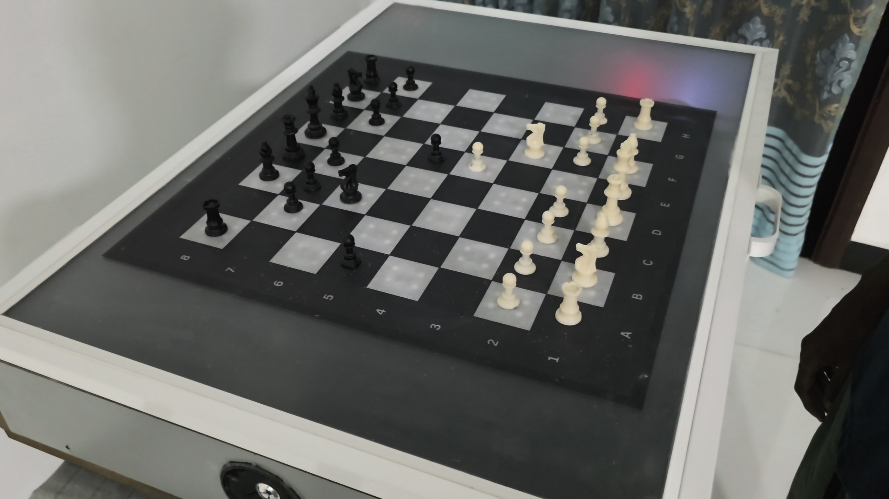

# Autonomous Chessboard

An ESP32-S3 autonomous chessboard that detects physical moves, validates them
with a companion server, and moves the engine's pieces with a CoreXY gantry and
electromagnet. The completed student prototype was demonstrated at the
University of Moratuwa in 2026.




## What It Does

- Detects square occupancy across all 64 squares through Hall-effect sensors and four 16-channel multiplexers.
- Guides the player with 256 addressable LEDs, four per square.
- Offers idle Exhibition lighting, an eight-column music Spectrum, and autonomous demonstration playback with placement recovery.
- Uses Stockfish for engine play and `chess.js` for game-state validation.
- Moves magnetic pieces with two NEMA17 motors, a CoreXY gantry, and an electromagnet.
- Provides a React control surface for games, calibration, and physical-board status.
- Adds a Gemini-powered voice mentor grounded in the live chess position.
- Plays mentor audio through dual MAX98357A I2S amplifiers.
- Supports a private-demo Spotify Connect relay through librespot, FFmpeg, Wi-Fi, and the ESP32 speakers.

## Technologies

| Layer | Main technologies |
| --- | --- |
| Board firmware | ESP32-S3, C++, Arduino framework, FreeRTOS |
| Companion interface | React, Vite, Socket.IO |
| Backend and game rules | Node.js, Express, `chess.js`, SQLite |
| Chess engine | Native Stockfish 19 through UCI |
| Voice mentoring | Google Gemini API and onboard I2S audio |
| Music and visualisation | librespot, FFmpeg, local PCM analysis and a 2,048-point FFT |

The laptop runs the backend, chess engine, mentoring integration, and music
relay. The ESP32 handles sensing, LEDs, audio playback, and motion. Physical
gameplay requires the backend connection. Hall sensors detect magnetic square
occupancy; the server tracks piece identities through the game state.

## Hardware

- ESP32-S3 N16R8 development board
- 64 Hall-effect sensors
- 4 x 16-channel multiplexers
- 256 WS2812-compatible LEDs
- 2 x NEMA17 stepper motors and A4988 drivers
- CoreXY gantry and switched electromagnet
- 2 x MAX98357A I2S amplifiers and speakers

The final speaker wiring avoids ESP32-S3 octal PSRAM pins:

| Signal | GPIO |
| --- | ---: |
| LRC/LRCLK | 9 |
| BCLK | 10 |
| DIN | 11 |

Final design exports are in [`hardware/`](hardware/), and the demonstration
deck is available at [`docs/final-presentation.pdf`](docs/final-presentation.pdf).

## Results

The integrated prototype was completed and demonstrated successfully. The
demonstration combined the production subsystems rather than presenting them
as isolated experiments:

- Full-board piece sensing and physical position synchronization
- Legal-move and game-state guidance through the 256-LED surface
- Stockfish move selection and automatic CoreXY piece movement
- Capture handling with an external graveyard route
- Browser control, calibration, difficulty selection, and live board telemetry
- Position-aware Gemini voice coaching through the onboard speakers
- Optional Spotify Connect playback over the local Wi-Fi relay

Final software verification on 9 November 2026 passed the client build and lint,
physical-state and motion-planning checks, shared settings, Mentor, Spotify,
Ultra, autonomous playback/recovery, Exhibition, and Spectrum regression suites.
The production ESP32-S3 compile gate passed at **1,908,183 bytes flash** and
**101,464 bytes static RAM**, using 16 MB flash and OPI PSRAM.

These software results are separate from physical acceptance. Feature-specific
notes retain the remaining hardware checks, including physical Ultra gameplay,
Spectrum sound-to-light timing/endurance, and autonomous recovery/restoration
scenarios. See the linked operation and acceptance documents below.

## My Contributions

This repository is maintained by **Thejaka Seneviratne**. My primary project
responsibilities were:

- Leading the CoreXY layout, construction, calibration, and board-coordinate mapping
- Leading the 64-square Hall-effect sensor system and multiplexer integration
- Designing and aligning the chessboard grid with the sensing and LED layers
- Building the companion application, Stockfish integration, and physical-board communication
- Integrating and debugging firmware, motion planning, mentor audio, and system-level behavior
- Supporting motor testing, electromagnet integration, driver wiring, and PCB routing

## Team

Chess Companion was built by **IT Group 27 - Roasted Resistors**:

| Member | Primary responsibilities |
| --- | --- |
| Thejaka Seneviratne | CoreXY, sensors, chessboard grid, companion application, integration |
| Sithum Sandaruwan | Speaker system, LED system, wiring and assembly support |
| Avindu Thilakarathne | Stepper motors, motor control, PCB and circuit design |
| Sahan Wijerathne | Enclosure, limit switches, power supply and distribution |
| Harishan Nirmalan | Electromagnet system, gantry and wiring support |

## Repository Layout

```text
app/                     Node/Express backend and React frontend
esp32_firmware/          Production ESP32-S3 firmware
firmware_tests/audio/    Speaker, Wi-Fi, filesystem, and power diagnostics
firmware_tests/hardware/ Motion, sensor, and LED diagnostics
firmware_tests/ota_led/  OTA/LED/sensor test sketch
hardware/                BOM, board pattern, schematics, PCB exports, and Gerbers
tools/                   Verification, setup, and audio-relay scripts
docs/                    Architecture, acceptance notes, and presentation
```

## Chess Engine

All game and Mentor analysis uses the full native Windows Stockfish 19 engine.
Run `./tools/setup-stockfish.ps1` once before starting the backend. The script
verifies the pinned official archive and tests the executable. An optional
`STOCKFISH_PATH` overrides the executable location.

The companion page offers **Ultra Mode** for virtual and ordinary physical games:
a fixed three-second search, with no deliberate weakening. The virtual preference
is remembered in that browser; physical changes apply to the current session.
Normal levels 1-15 remain available. Mentor activities retain normal difficulty.
See [engine setup and Ultra](docs/stockfish-ultra.md).

## Getting Started

The provided setup targets **Windows x64**. Use **Node.js 22.13 or newer**;
final verification used Node.js 24.14.0. Git is needed to clone the project.
Gemini mentoring needs your own API key. Physical play additionally requires
the assembled board and the firmware setup below.

From PowerShell:

```powershell
git clone https://github.com/The-Jaaa/esp32-autonomous-chessboard.git
cd esp32-autonomous-chessboard
.\tools\setup-stockfish.ps1

cd app
npm ci
Copy-Item .env.example .env
```

Before starting the backend, edit `app/.env` with your own Gemini key, the
laptop's Wi-Fi IPv4 address, and a private `ESP32_AUDIO_TOKEN`. Use the same
audio token in the firmware configuration. Keep the real configuration files
local; example files are included in the repository.

Build the companion interface and start the server:

```powershell
# From app/
cd client
npm ci
npm run build
cd ..
npm start
```

Open **http://localhost:3000** for the companion page or
**http://localhost:3000/mentor** for voice mentoring. Keep the backend terminal
running. For frontend development, run `npm run dev` from `app/client/` in a
second terminal and open the Vite URL; API and WebSocket traffic is proxied to
the backend on port 3000.

## Exhibition Modes

The companion page includes a Light Show panel and an Autonomous Game panel:

- **Light Show:** select a pattern, start or stop it, and adjust brightness.
- **Spectrum:** eight coloured bars across files A-H react to music through the
  board's Spotify relay. Bass is on A, treble on H, and bars rise toward rank 8.
  Timing follows the audio, so the Speed control is disabled.
- **Autonomous Game:** replay the reviewed Tal-Shamkovich game, reverse verified
  transfers to restore the pieces, and repeat. Pause, restoration, takeover,
  and placement-recovery controls use the existing motion and sensing guards.

Ordinary Light Show operation is idle-only. Autonomous playback has a guarded
path for retaining music/Spectrum during its demonstration. Physical-game and
Mentor ownership checks remain in place. Operation and limitations are detailed
in [Exhibition modes](docs/exhibition-modes.md),
[autonomous playback](docs/autonomous-exhibition.md), and
[placement recovery](docs/autonomous-recovery.md).

## Firmware

The production sketch is in `esp32_firmware/`. Copy
`firmware_secrets.example.h` to the ignored `firmware_secrets.h`, fill in the
local Wi-Fi and backend values. Install the Espressif ESP32 Arduino board package
and the libraries used by the production sketch: **ArduinoJson**, **AccelStepper**,
**Adafruit NeoPixel**, and **ESP32-audioI2S** (`Audio.h`). The audio library must
provide the `audio_process_i2s` PCM callback used by Spectrum. The verified build
uses ESP32 core **3.3.8**, ArduinoJson **7.4.3**, AccelStepper **1.64**,
Adafruit NeoPixel **1.15.5**, and ESP32-audioI2S **3.4.6**. Compile for an
ESP32-S3 N16R8 using:

- CPU frequency: 240 MHz
- Flash size: 16 MB
- PSRAM: OPI PSRAM
- Partition scheme: 3 MB app / 9 MB filesystem

The board and laptop server must be on the same private Wi-Fi network. Use the
laptop's current Wi-Fi IPv4 address in both `app/.env` and
`esp32_firmware/firmware_secrets.h`. Hotspot addresses can change after reconnecting;
update both configurations, rebuild/upload the firmware, and restart the backend
when that happens. A DHCP reservation can keep the server address stable.

## Verification

Browser regressions use Microsoft Edge on Windows and `playwright-core`
(`npm install --no-save playwright-core` from `app/` if it is not available).
Portable firmware tests require a C++17 compiler (`g++` on PATH, or set `CXX`).
Build the client before running browser checks; avoid rebuilding it while those
checks are running.

Run the backend regression suites from `app/`:

```powershell
npm run test:foundation
npm run test:mentor
npm run test:spotify
npm run test:ultra
npm run test:autonomous
npm run test:exhibition
npm run test:music-spectrum
```

The combined foundation gate can also be run from the repository root with
`.\tools\verify-foundation.ps1`; it includes the client checks and production
firmware compile and requires Arduino CLI. This command compiles without uploading.

Hardware acceptance and recovery procedures are documented in
[`docs/demo-readiness.md`](docs/demo-readiness.md) and
[`docs/spotify-relay-acceptance.md`](docs/spotify-relay-acceptance.md).

## Spotify Demo

The Spotify path is an optional private demonstration feature. It requires
Spotify Premium and the unofficial librespot receiver. Spotify controls the
track; the laptop receives PCM, FFmpeg mixes and encodes it, and the ESP32
decodes the authenticated LAN stream to I2S. See
[`tools/audio-relay/README.md`](tools/audio-relay/README.md).

Do not commit or redistribute streamed music, librespot credentials, portable
binaries, generated captures, Wi-Fi credentials, or API keys.

## License

Project source is released under the [MIT License](LICENSE). Third-party tools
and libraries retain their respective licenses. Stockfish and librespot are
separate upstream projects; downloaded distributions and local credentials are
not included in this repository.
