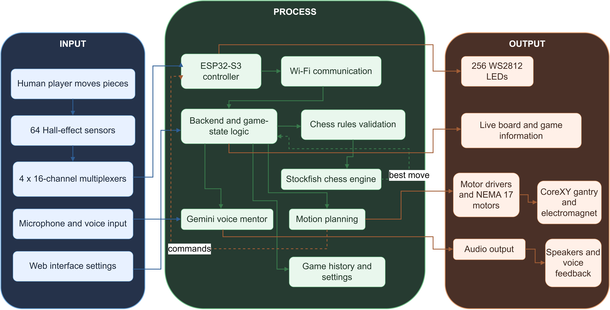

# Autonomous Chessboard

An ESP32-S3 autonomous chessboard that detects physical moves, validates them
with a companion server, and moves the engine's pieces with a CoreXY gantry and
electromagnet. The completed student prototype was demonstrated at the
University of Moratuwa in 2026.



## What It Does

- Detects all 64 squares through Hall-effect sensors and four 16-channel multiplexers.
- Guides the player with 256 addressable LEDs, four per square.
- Uses Stockfish for engine play and `chess.js` for game-state validation.
- Moves magnetic pieces with two NEMA17 motors, a CoreXY gantry, and an electromagnet.
- Provides a React control surface for games, calibration, and physical-board status.
- Adds a Gemini-powered voice mentor grounded in the live chess position.
- Plays mentor audio through dual MAX98357A I2S amplifiers.
- Supports a private-demo Spotify Connect relay through librespot, FFmpeg, Wi-Fi, and the ESP32 speakers.

## Hardware

- ESP32-S3 N16R8 development board
- 64 Hall-effect sensors
- 4 x 16-channel multiplexers
- 256 WS2812-compatible LEDs
- 2 x NEMA17 stepper motors and A4988 drivers
- CoreXY gantry and switched electromagnet
- 2 x MAX98357A I2S amplifiers and speakers

The final speaker wiring avoids ESP32-S3 octal PSRAM pins:

| Signal | GPIO |
| --- | ---: |
| LRC/LRCLK | 9 |
| BCLK | 10 |
| DIN | 11 |

Final design exports are in [`hardware/`](hardware/), and the demonstration
deck is available at [`docs/final-presentation.pdf`](docs/final-presentation.pdf).

## Repository Layout

```text
app/                     Node/Express backend and React frontend
esp32_firmware/          Production ESP32-S3 firmware
firmware_tests/audio/    Speaker, Wi-Fi, filesystem, and power diagnostics
firmware_tests/hardware/ Motion, sensor, and LED diagnostics
firmware_tests/ota_led/  OTA/LED/sensor test sketch
hardware/                Schematics, PCB exports, and Gerber files
tools/                   Verification, setup, and audio-relay scripts
docs/                    Architecture, acceptance notes, and presentation
```

## Companion App

Requirements: Node.js 20 or newer, a local Stockfish-compatible environment,
and credentials supplied through an ignored `.env` file.

```powershell
cd app
npm install
Copy-Item .env.example .env
npm start
```

In a second terminal:

```powershell
cd app/client
npm install
npm run dev
```

Open the Vite URL shown in the terminal. Configure `app/.env` with your own
Gemini key, LAN address, and audio token. Never commit that file.

## Firmware

The production sketch is in `esp32_firmware/`. Copy
`firmware_secrets.example.h` to the ignored `firmware_secrets.h`, fill in the
local Wi-Fi and backend values, and compile for an ESP32-S3 N16R8 using:

- CPU frequency: 240 MHz
- Flash size: 16 MB
- PSRAM: OPI PSRAM
- Partition scheme: 3 MB app / 9 MB filesystem

The board and laptop server must be on the same private Wi-Fi network.

## Verification

Run the backend regression suites from `app/`:

```powershell
npm run test:foundation
npm run test:mentor
npm run test:spotify
```

Hardware acceptance and recovery procedures are documented in
[`docs/demo-readiness.md`](docs/demo-readiness.md) and
[`docs/spotify-relay-acceptance.md`](docs/spotify-relay-acceptance.md).

## Spotify Demo

The Spotify path is an optional private demonstration feature. It requires
Spotify Premium and the unofficial librespot receiver. Spotify controls the
track; the laptop receives PCM, FFmpeg mixes and encodes it, and the ESP32
decodes the authenticated LAN stream to I2S. See
[`tools/audio-relay/README.md`](tools/audio-relay/README.md).

Do not commit or redistribute streamed music, librespot credentials, portable
binaries, generated captures, Wi-Fi credentials, or API keys.

## License

Released under the [MIT License](LICENSE).
